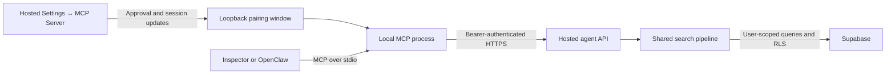

# Local MCP search for hosted Tamarind

This proof of concept lets an MCP client search knowledge through hosted Tamarind with the permissions of an explicitly connected platform owner. It is disabled by default. It exposes one read-only tool and creates no database tables or persistent pairing records.

## What each component does

**MCP (Model Context Protocol)** lets an agent application discover tools and call them with structured arguments. The **MCP client/host**, such as MCP Inspector or eventually OpenClaw, starts Tamarind's local MCP process. **Stdio** means that they communicate through the process's standard input and output; it is not a public network MCP server.

The **hosted Tamarind app** performs authentication, authorization, embeddings and search. The **local MCP process** is an adapter: it holds a browser-supplied access token in memory and calls the hosted HTTPS API. It never queries Supabase directly. A local Tamarind app is neither needed nor a substitute for the hosted endpoints in this setup.

The **auth-pairing window** is a small page served on `127.0.0.1` by the local process. It connects the signed-in hosted browser tab to that particular process using validated window messages and a one-time pairing code. It is separate from the stdio MCP connection.



## Prerequisites and access

- Install the repository dependencies with Bun (`bun install`). Node.js is also needed to run Inspector through `npx`; consult the installed Inspector's requirements.
- Deploy the new Settings tab and agent endpoints to the hosted app using the normal Lovable deployment workflow. Local branch changes alone do not create these hosted endpoints.
- Sign into hosted Tamarind in desktop Chrome. Chrome is the initial POC target; the deployed browser flow still needs acceptance testing.
- The account's authoritative email must be in the hosted server's `PLATFORM_OWNER_EMAILS` allowlist **and** the account must have the `admin` role in the selected workspace. Ordinary workspace-admin status alone is insufficient.
- Run the browser and MCP process on the same computer. `127.0.0.1` refers to that computer; a remotely running MCP host cannot use this pairing arrangement unchanged.

No Supabase dashboard access, local Supabase access, service-role key, password entry in the local process, or manual access-token copying is required.

## Configuration: hosted server versus local process

| Variable | Where to configure it | Meaning |
|----------|-----------------------|---------|
| `TAMARIND_AGENT_SEARCH_ENABLED` | Hosted Tamarind server environment through the existing Lovable/deployment configuration | Exactly `true` enables the tab and HTTP endpoints. Missing/other values keep them disabled. |
| `TAMARIND_APP_URL` | Ignored local `.env.mcp.local` | Required HTTPS origin of the hosted app, e.g. `https://app.tamarind.so`. No credentials, non-root path, query or fragment. |
| `TAMARIND_MCP_PAIRING_PORT` | Ignored local `.env.mcp.local`, optional | Fixed loopback port from 1 through 65535. Omit it to allocate an available port automatically. |

The hosted app also uses its existing Supabase publishable-key configuration and `PLATFORM_OWNER_EMAILS`. `OPENAI_API_KEY` remains a hosted search dependency for semantic embeddings; existing keyword fallback still applies. The local process does not need these settings.

Create `.env.mcp.local` in the repository root:

```dotenv
TAMARIND_APP_URL=https://app.tamarind.so

# Optional: choose a stable pairing address instead of an allocated port.
TAMARIND_MCP_PAIRING_PORT=43127
```

This file is already covered by the repository's ignore rules. Do not place credentials in the tracked `.env` file. Do not add `TAMARIND_ACCESS_TOKEN`, a refresh token, or a `VITE_` credential variable. Tokens arrive only through the approved browser bridge and are not written to disk by this integration.

These addresses serve different purposes:

```text
https://app.tamarind.so          hosted app; receives searches and verifies access
http://127.0.0.1:43127          local listener; serves the auth-pairing window
```

For a direct launch from the repository root:

```bash
bun --env-file=.env.mcp.local src/integrations/mcp/server.ts
```

The `mcp:search` script is also available when those variables are already in the environment. Starting the executable directly makes it wait for an MCP client on stdin; it does not provide a standalone search prompt. Normally let Inspector or the chosen host launch it.

## Full MCP Inspector walkthrough

Inspector is a development client that can discover and invoke the actual MCP tool without configuring OpenClaw. From the repository root, launch:

```bash
npx @modelcontextprotocol/inspector \
  bun --env-file=.env.mcp.local src/integrations/mcp/server.ts
```

1. Open the Inspector browser URL printed by the launcher and connect with **stdio** using the supplied Bun command. Inspector launches the local process; do not separately launch a second copy.
2. Find the process's stderr diagnostics in Inspector or its launching terminal. They contain a local address and a 22-character pairing code valid for five minutes. These diagnostics deliberately display the one-time pairing code; access tokens are never printed.
3. Open the matching **hosted** Tamarind app and sign in normally. Open the desired workspace, then **Workspace settings → MCP Server**. If the tab is absent, check both admin gates and hosted feature enablement.
4. Enter the address exactly as displayed, such as `http://127.0.0.1:43127`, and the pairing code. Click **Connect**. Allow the popup if Chrome blocks it.
5. A small local auth-pairing window opens. The tab and window validate the pairing code and challenge before any access token is sent.
6. In Tamarind Settings, review the account, workspace ID and local process address. Click **Approve connection** to explicitly share the session with this process.
7. The process calls hosted `/api/agents/session`, which verifies the account, allowlist and workspace-admin role. Only successful verification changes status to **Connected**. The code is consumed and cannot be reused.
8. In Inspector's Tools view, list tools and select **`search_knowledge`**. Discovery works before pairing, but searches require an active connection.
9. Submit a query for a distinctive phrase in an accessible page. The workspace ID is the UUID in the hosted `/w/<workspaceId>` URL.

```json
{
  "workspaceId": "11111111-1111-4111-8111-111111111111",
  "query": "a known page title",
  "scope": "pages"
}
```

10. Inspect the structured result and open its source links. A successful discovery checks MCP wiring; finding a known source checks the full authenticated retrieval path.
11. In Tamarind, click **Disconnect**. Subsequent Inspector calls must fail with a connection-required error. Stopping the MCP process also clears its session.

Inspector is optional in normal use. OpenClaw can eventually launch the same command and invoke the same tool, but its registration and diagnostics UI are outside this POC's implementation and have not been verified here.

## Search contract and HTTP API

The `search_knowledge` arguments match the hosted `POST /api/agents/search` body:

| Argument | Requirement |
|----------|-------------|
| `workspaceId` | UUID; must match the locally paired workspace |
| `query` | Nonblank text, maximum 2,000 characters |
| `scope` | Optional `all` (default), `pages`, `conversations`, or `users` |

Unknown fields are rejected. Tokens, URLs, user IDs, strategy switches, pagination, and result-count arguments are not accepted.

The response contains `workspaceId`, the effective `scope`, and up to **20 globally ranked merged results**, each with `id`, `sourceType` (`page`, `conversation`, `message`), `title`, `snippet`, and absolute `url`. Titles are limited to 300 characters and snippets to 500. Message and untitled-content fallbacks match the human UI. No full documents or embeddings are returned.

Links open existing Tamarind workspace targets: pages use `p`, page chunks additionally use `k`, conversations use `c`, and messages additionally use `m`. Messages without a parent conversation ID are omitted. The `users` scope searches participant names and returns matched **conversations**, not profile records.

The hosted API authenticates the user and rechecks platform ownership and workspace-admin status on **every request**. All retrieval runs through the shared user-scoped search wrapper and existing RLS. The session-verification endpoint accepts only `{ "workspaceId": "uuid" }` and returns verified `userId`, `email`, `workspaceId`, and `expiresAt` (Unix milliseconds), without running search or creating a record.

| HTTP status | Meaning |
|-------------|---------|
| 200 | Authorized response; a search may have no results |
| 400 | Invalid JSON, input or oversized body |
| 401 | Missing, invalid or expired user authentication |
| 403 | Account lacks platform-owner or workspace-admin eligibility |
| 404 | Feature disabled or endpoint not deployed |
| 405 | Method other than POST |
| 500 | Configuration, authorization lookup or unexpected execution failure |

Responses use `Cache-Control: no-store`; errors do not expose database details. The local adapter uses a 15-second HTTP timeout, refuses redirects and performs no automatic retries. HTTP 401/403 clears local authorization.

Existing search preprocessing and ranking are preserved. A nonblank query that becomes too short or empty after preprocessing returns an empty success. Keyword/semantic strategy errors and timeouts can also produce partial or empty successes; an empty result does **not** prove there is no relevant knowledge. See [Search Pipeline](../search/pipeline.md).

## Token updates and connection lifetime

The current browser access token is shared only after approval. Refreshed access tokens from Tamarind's existing auth context are verified by the hosted endpoint before replacing the local copy. Refresh tokens never leave the browser through this bridge.

- Keep the **hosted Tamarind tab and auth-pairing window open**. Closing Settings is safe; reopening it shows the existing connection.
- The hosted tab supplies heartbeats every 30 seconds. The local process expires authorization after five minutes without renewal, and never beyond the current token's expiration. The local window alone cannot keep the lease alive.
- Browser freezing, computer sleep or network failure can interrupt renewal. Expiration fails closed and requires pairing again.
- Sign-out, account/workspace changes, popup closure and explicit Disconnect initiate cleanup. A vanished tab cannot guarantee immediate cleanup; the lease is the fallback.
- Full-page reloads and local-process restarts require fresh pairing. One active connection is supported per process and per initiating tab.
- Restart or use the newly printed code after a failed/expired pairing attempt. A challenge that was abandoned cannot later install an asynchronously verified session.

Disconnect clears this process's credentials; it does not revoke the underlying Supabase token everywhere. Although the MCP adapter exposes only read-only search, the user token itself has the account's normal permissions. Pair only with the local process you started. Workspace binding is enforced by this adapter, not cryptographically by the Supabase token.

## Troubleshooting and browser constraints

| Symptom | Check |
|---------|-------|
| MCP Server tab missing | Hosted deployment, `TAMARIND_AGENT_SEARCH_ENABLED=true`, authoritative email allowlist and selected-workspace admin role |
| Process exits at startup | HTTPS app origin, installed dependencies, valid/free optional pairing port |
| Pairing code invalid or already in use | Use the latest code from that exact process; wait for replacement or restart after abandoning an early attempt |
| Popup blocked | Allow popups for hosted Tamarind and click Connect again |
| Pairing times out or `window.opener` is unavailable | Open hosted Tamarind in its own tab; inspect popup restrictions and deployed COOP/security headers. Do not weaken global security headers as a workaround |
| Browser requests local-network permission | Evaluate the prompt for this local process. Browser/local-network behavior must be checked on the target Chrome version |
| HTTP 404 | The configured hosted origin may lack the endpoints or have the feature disabled |
| HTTP 401/403 | Reconnect; verify session validity, allowlist and workspace-admin role |
| Workspace mismatch | Search the workspace you approved, or disconnect and pair again for another workspace |
| Empty results | Try a known accessible source and `pages` scope; inspect hosted search diagnostics for existing fallback behavior |
| Connection expires while idle | Background-tab throttling, sleep or browser suspension can stop heartbeats; pair again |

Window messages require the expected exact origin, source window and fresh challenge/request identity. The loopback server accepts only its exact Host and same-origin JSON POSTs with valid pairing or bridge credentials. It has no wildcard CORS, token-reading endpoint, general proxy or MCP HTTP transport. The popup page loads no external scripts.

## Verification and outstanding acceptance

Run offline tests with `bun test`; the suite uses synthetic sessions, mocked hosted requests and loopback listeners. No real Tamarind login or Supabase calls are made. A restricted execution sandbox may need loopback permission for transport tests.

Offline coverage includes hosted authorization/HTTP contracts, shared search compatibility, result links, pairing/replay/expiry, window-message filtering, explicit approval, token updates, lease/disconnect behavior, loopback protections, actual stdio discovery and shutdown. Production build and TypeScript checks verify module boundaries; these do not establish deployed RLS or real-browser compatibility.

**Deferred acceptance:** after owner-managed deployment/authentication, run the Inspector walkthrough in desktop Chrome, test a known query and restricted content, open links, verify refreshed tokens, and verify disconnect/role removal. Hosted headers, popup behavior and actual Supabase policies remain unverified until this is done. Configuring OpenClaw remains a separate task.

## Related documentation

- [API Routes](../api/readme.md)
- [Authentication](auth.md)
- [Deployment](deployment.md)
- [Tests](tests.md)
- [Workspaces & Permissions](../interface/workspaces_permissions.md)
- [Search Overview](../search/readme.md)

Official protocol tooling: [MCP TypeScript SDK](https://github.com/modelcontextprotocol/typescript-sdk), [MCP Inspector](https://github.com/modelcontextprotocol/inspector).
